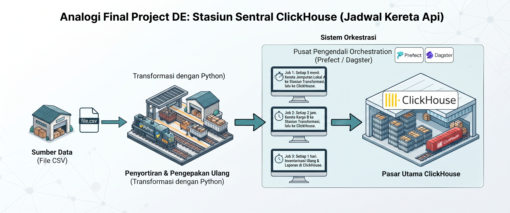

# Bootcamp Data Engineer Pemula

Repository ini digunakan untuk menyimpan materi, latihan, tugas, dan catatan selama mengikuti **Bootcamp Data Engineer Pemula**.

Bootcamp ini membahas dasar-dasar data engineering secara bertahap, mulai dari pengenalan peran data engineer, pengolahan data dengan SQL dan Python, hingga pembuatan alur data sederhana.

## Tujuan Repository

- Menyimpan materi dan hasil praktik setiap pertemuan.
- Mendokumentasikan proses belajar dan catatan penting.
- Menjadi portofolio latihan dasar data engineering.
- Memudahkan pelacakan tugas dan progres bootcamp.

## Struktur Repository

```text
.
├── README.md
├── pertemuan-1/
│   └── README.md
├── pertemuan-2/
│   └── README.md
├── pertemuan-3/
│   └── README.md
├── pertemuan-4/
│   └── README.md
├── pertemuan-5/
│   └── README.md
├── pertemuan-6/
│   └── README.md
└── pertemuan-7/
    └── README.md
```

## Daftar Pertemuan

| Pertemuan | Fokus Pembelajaran | Dokumentasi |
|---|---|---|
| 1 | Pengenalan Data Engineering | [README Pertemuan 1](./pertemuan-1/README.md) |
| 2 | Python untuk Data Engineering | [README Pertemuan 2](./pertemuan-2/README.md) |
| 3 | Data Cleaning & Transformation | [README Pertemuan 3](./pertemuan-3/README.md) |
| 4 | Database & SQL Integration | [README Pertemuan 4](./pertemuan-4/README.md) |
| 5 | Data Pipeline Automation | [README Pertemuan 5](./pertemuan-5/README.md) |
| 6 | Advanced ETL & Final Project Briefing | [README Pertemuan 6](./pertemuan-6/README.md) |
| 7 | Presentasi Final Project & Best Practices | [README Pertemuan 7](./pertemuan-7/README.md) |

> Topik pertemuan dapat disesuaikan dengan silabus dan pelaksanaan bootcamp.

Silabus yang menjadi acuan tersedia pada file [Silabus Bootcamp Data Engineering dengan Python](./Silabus%20Bootcamp%20Data%20Engineering%20dengan%20Python%20-%20Silabus%20Original%20%28do%20not%20edit%29.csv).

## Final Project

Final project merupakan proyek individu untuk membangun simulasi data pipeline dari sumber data hingga data siap digunakan di ClickHouse.

### Alur Final Project

1. **Extract** — mengambil data dari file CSV.
2. **Transform** — membersihkan, mengubah, dan menyiapkan data menggunakan Python.
3. **Orchestration** — menjadwalkan dan mengatur proses menggunakan Prefect atau Dagster.
4. **Load** — menyimpan hasil transformasi ke ClickHouse.
5. **Scheduling** — menjalankan pekerjaan sesuai kebutuhan, misalnya setiap 5 menit, setiap 2 jam, atau setiap hari.



_Flow final project: file CSV diproses dengan Python, dijadwalkan oleh sistem orkestrasi, lalu dimuat ke ClickHouse._

### Target Final Project

- Membuat pipeline sederhana dari CSV ke ClickHouse.
- Melakukan transformasi data menggunakan Python.
- Menjalankan pipeline secara terjadwal.
- Menyimpan hasil pipeline ke database analitik.
- Menyusun laporan dan presentasi hasil project.

## Cara Menggunakan Repository

1. Masuk ke folder pertemuan yang sedang dipelajari.
2. Baca README pada folder tersebut.
3. Simpan script, query, dataset kecil, dan hasil latihan di folder pertemuan terkait.
4. Perbarui README dengan progres, kendala, dan hasil belajar.

## Teknologi yang Digunakan

Teknologi dapat berkembang sesuai kebutuhan bootcamp. Beberapa teknologi yang dipelajari antara lain:

- Linux dan command line
- Git dan GitHub
- SQL dan database relasional
- Python
- Pandas
- ETL dan data pipeline
- Orkestrasi workflow dasar

## Status Pembelajaran

- [ ] Pertemuan 1
- [ ] Pertemuan 2
- [ ] Pertemuan 3
- [ ] Pertemuan 4
- [ ] Pertemuan 5
- [ ] Pertemuan 6
- [ ] Pertemuan 7

## Catatan

Repository ini dibuat untuk kebutuhan belajar. Pastikan tidak menyimpan data sensitif, kredensial, password, API key, atau data pribadi ke dalam repository.
