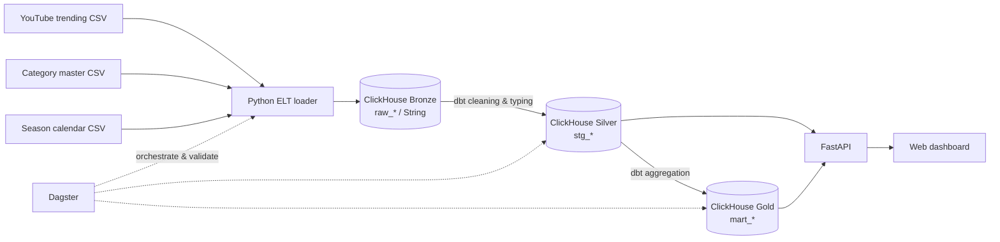

# YouTube Trending Analytics — Final Project

Pipeline ELT untuk mengolah dataset YouTube Trending Indonesia menjadi data siap analisis. CSV dimuat ke ClickHouse, ditransformasi dengan dbt memakai medallion architecture, diorkestrasi dengan Dagster, lalu disajikan melalui FastAPI dan web dashboard.

Use case utama project ini adalah membantu data analyst melakukan trend analysis, creator analytics, engagement research, content strategy, dan cultural/seasonal analysis.

## Arsitektur



Alur Dagster menjalankan `load_bronze → build_silver → build_gold → run_data_tests → validate_warehouse` secara berurutan.

## Teknologi

- ClickHouse 24.8 sebagai data warehouse.
- Python dan `clickhouse-connect` untuk extract dan load CSV.
- dbt Core dan `dbt-clickhouse` untuk transformasi Silver dan Gold.
- Dagster untuk orchestration, retry, logging, validation, dan schedule.
- FastAPI untuk API analitik.
- HTML, CSS, JavaScript, dan Chart.js untuk web dashboard.
- Docker Compose untuk menjalankan semua service secara terisolasi.

## Struktur project

| Path | Kegunaan |
|---|---|
| `data/source/` | Dataset utama YouTube Trending Indonesia |
| `data/master/` | Master kategori dan kalender seasonal |
| `ingestion/load_clickhouse.py` | Load ketiga CSV ke tabel `bronze.raw_*` |
| `dbt/models/silver/` | Cleaning, typing, UTC ke WIB, dan enrichment |
| `dbt/models/gold/` | Agregasi dan mart siap analisis |
| `dbt/dbt_project.yml` | Konfigurasi project transformasi dbt |
| `orchestration/definitions.py` | Job, ops, retry policy, validation, dan schedule Dagster |
| `orchestration/Dockerfile` | Image Dagster, dbt, dan ingestion |
| `dashboard/` | FastAPI, query chart, UI/UX, asset static, dan Dockerfile dashboard |
| `docker-compose.yml` | ClickHouse, Dagster webserver/daemon, dan dashboard |
| `scripts/run_pipeline.sh` | Alternatif menjalankan pipeline dari host tanpa UI Dagster |
| `laporan/` | Laporan final, source Markdown/generator, dan template Word asli |
| `slides/` | Slide automation, scheduling, orchestration, serta perbandingan Dagster, Kestra, dan Prefect |

## Prasyarat

Pastikan tersedia:

- Docker Desktop atau Docker Engine.
- Docker Compose v2, dicek dengan `docker compose version`.
- Port host `18123`, `19000`, `13000`, dan `18080` tidak sedang dipakai.
- Koneksi internet saat build pertama dan saat membuka dashboard. Chart.js dan font frontend dimuat melalui CDN.

Python dan dbt lokal tidak dibutuhkan jika pipeline dijalankan melalui Dagster/Docker.

## Quick start — menjalankan semua service

Jalankan command dari root repository:

```bash
cd final-project
docker compose up -d --build
docker compose ps
```

Tunggu sampai `youtube-trend-clickhouse` dan `youtube-trend-dashboard` berstatus `healthy`. Dagster webserver dan daemon cukup berstatus `Up`.

`docker compose up` hanya menyalakan service. Pada instalasi pertama, data dashboard belum tersedia sampai job pipeline dijalankan.

### Menjalankan pipeline melalui Dagster

1. Buka `http://localhost:13000`.
2. Masuk ke **Jobs** dan pilih `youtube_trending_elt_job`.
3. Klik **Launchpad**, lalu **Launch Run**.
4. Tunggu seluruh lima tahap berwarna hijau dan run berstatus **Succeeded**.
5. Buka `http://localhost:18080`, lalu refresh dashboard.

Job tersebut akan:

1. Memuat semua CSV ke Bronze dengan tipe kolom `String`.
2. Menjalankan cleaning dan typing ke Silver.
3. Membuat lima mart Gold.
4. Menjalankan dbt data tests.
5. Memastikan tabel penting tidak kosong dan aliran row count konsisten.

### URL service

| Service | URL/port host | Keterangan |
|---|---|---|
| Dagster UI | `http://localhost:13000` | Menjalankan dan memonitor pipeline |
| Web dashboard | `http://localhost:18080` | Dashboard analitik |
| Swagger API | `http://localhost:18080/docs` | Dokumentasi dan percobaan endpoint |
| API health | `http://localhost:18080/api/health` | Koneksi FastAPI ke ClickHouse |
| ClickHouse HTTP | `http://localhost:18123` | Port HTTP ClickHouse |
| ClickHouse native | `localhost:19000` | Port native client |

Port dibuat berbeda dari folder pertemuan sebelumnya agar service tidak berbenturan.

## Alternatif menjalankan pipeline dari terminal

### Di dalam container Dagster — direkomendasikan

Pastikan semua service sudah aktif, kemudian jalankan:

```bash
docker compose exec dagster-webserver python ingestion/load_clickhouse.py
docker compose exec dagster-webserver dbt run --project-dir dbt --profiles-dir dbt
docker compose exec dagster-webserver dbt test --project-dir dbt --profiles-dir dbt
```

Cara ini memakai dependency dan hostname ClickHouse yang sudah disiapkan di Docker.

Untuk menjalankan layer tertentu saja:

```bash
docker compose exec dagster-webserver dbt run --project-dir dbt --profiles-dir dbt --select path:models/silver
docker compose exec dagster-webserver dbt run --project-dir dbt --profiles-dir dbt --select path:models/gold
```

Bronze selalu dimuat sebelum Silver, dan Silver harus selesai sebelum Gold.

### Langsung dari komputer host

Opsi ini membutuhkan Python 3 dan instalasi dependency lokal:

```bash
python3 -m venv .venv
source .venv/bin/activate
pip install -r orchestration/requirements.txt
bash scripts/run_pipeline.sh
```

`scripts/run_pipeline.sh` menyalakan ClickHouse, memuat Bronze, menjalankan seluruh model dbt, kemudian menjalankan dbt test. Script ini tidak menyalakan Dagster UI dan dashboard jika keduanya belum aktif; gunakan `docker compose up -d` untuk menyalakannya.

## Detail medallion architecture

### Bronze

Loader membuat dan me-refresh tabel berikut:

- `bronze.raw_youtube_trending`
- `bronze.raw_category_master`
- `bronze.raw_season_calendar`

Semua kolom dipertahankan sebagai `String`. Setiap pipeline dijalankan, isi tabel Bronze di-`TRUNCATE` lalu dimuat ulang agar hasilnya idempotent dan tidak menggandakan data.

### Silver

Model `silver.stg_youtube_trending` melakukan:

- Menghapus suffix `UTC`, parsing `DateTime`, lalu menambah tujuh jam untuk WIB.
- Mengubah rank, category ID, views, likes, comments, dan duration ke tipe numerik.
- Mengubah durasi `HH:MM:SS` menjadi detik dan menit.
- Merapikan whitespace pada nama channel dan tags serta trimming title.
- Mengganti likes/comments kosong menjadi `0`.
- Memfilter video ID/timestamp kosong, views negatif, dan rank di luar `1–50`.
- Menggabungkan category ID dengan master category.
- Menghitung engagement rate `(likes + comments) / views`.

Model `silver.stg_season_calendar` membersihkan dan memvalidasi rentang tanggal seasonal.

### Gold

| Tabel | Kegunaan |
|---|---|
| `gold.mart_daily_category_trends` | Tren kategori harian |
| `gold.mart_monthly_content_trends` | Tren kategori bulanan dan tahunan |
| `gold.mart_channel_trends` | Frekuensi channel masuk trending |
| `gold.mart_seasonal_trends` | Perbandingan seasonal dan regular period |
| `gold.mart_content_performance` | Views, likes, comments, rank, durasi, dan engagement |

## Verifikasi hasil pipeline

Cek health API:

```bash
curl http://localhost:18080/api/health
```

Cek row count seluruh layer:

```bash
docker compose exec clickhouse clickhouse-client \
  --user clickhousedev \
  --password adminpass123 \
  --query "SELECT database, table, total_rows FROM system.tables WHERE database IN ('bronze','silver','gold') ORDER BY database, table"
```

Dengan file dataset yang saat ini disertakan, indikator utamanya adalah:

- `bronze.raw_category_master`: 15 baris.
- `bronze.raw_youtube_trending`: 61.169 baris.
- `silver.stg_youtube_trending`: 61.169 baris.
- `gold.mart_content_performance`: 61.169 baris.
- Rentang data: 14 Agustus 2022 sampai 4 Maret 2026.

Jumlah dapat berubah jika CSV sumber diperbarui. Yang wajib adalah tabel tidak kosong dan validasi Dagster berhasil.

## Dashboard dan API

Dashboard menyediakan filter tanggal, kategori, dan granularitas serta dark mode. Frontend memakai endpoint berikut:

| Endpoint | Kegunaan |
|---|---|
| `/api/filters` | Rentang tanggal dan pilihan kategori |
| `/api/overview` | KPI appearances, video, channel, engagement, dan top category |
| `/api/category-trends` | Tren kategori harian atau bulanan |
| `/api/top-channels` | Ranking creator/channel |
| `/api/engagement-scatter` | Hubungan views, likes, comments, dan rank |
| `/api/duration-performance` | Analisis performa berdasarkan durasi |
| `/api/rank-performance` | Analisis berdasarkan posisi trending |
| `/api/seasonal` | Ramadan, pemilu, akhir tahun, dan regular period |

Contoh request endpoint yang membutuhkan tanggal:

```bash
curl "http://localhost:18080/api/overview?start_date=2022-08-14&end_date=2026-03-04"
```

SQL chart berada di `dashboard/app.py`. Filter memakai typed query parameters untuk mencegah input tanggal dan kategori disisipkan langsung ke SQL.

## Schedule Dagster

Schedule `daily_youtube_trending_schedule` disiapkan setiap hari pukul `02:00` WIB. Schedule sengaja berstatus **Stopped** secara default agar pipeline tidak berjalan tanpa disengaja.

Untuk mengaktifkannya, buka Dagster UI → **Automation** → **Schedules** → aktifkan `daily_youtube_trending_schedule`. Service `dagster-daemon` harus tetap hidup agar schedule dieksekusi.

## Operasional Docker

Melihat status dan log:

```bash
docker compose ps
docker compose logs -f dagster-webserver dagster-daemon
docker compose logs -f dashboard
docker compose logs -f clickhouse
```

Restart service tertentu:

```bash
docker compose restart dashboard
docker compose restart dagster-webserver dagster-daemon
```

Menghentikan service tanpa menghapus data:

```bash
docker compose down
```

Menghapus seluruh container **beserta data ClickHouse dan history Dagster**:

```bash
docker compose down -v
```

> Peringatan: opsi `-v` menghapus volume `clickhouse_data` dan `dagster_home`. Pipeline harus dijalankan ulang setelah reset.

## Troubleshooting

### Dashboard menampilkan “Data belum dapat dimuat”

1. Pastikan job Dagster sudah berstatus **Succeeded**.
2. Cek `docker compose ps`; ClickHouse dan dashboard harus `healthy`.
3. Cek `curl http://localhost:18080/api/health`.
4. Lihat error dengan `docker compose logs --tail=100 dashboard`.
5. Lakukan hard refresh browser (`Cmd + Shift + R` di macOS atau `Ctrl + Shift + R` di Windows/Linux).

Jika KPI tampil tetapi grafik tidak muncul, pastikan browser dapat mengakses CDN Chart.js.

### Endpoint analitik menghasilkan HTTP 422

Endpoint seperti `/api/overview` membutuhkan `start_date` dan `end_date` berformat `YYYY-MM-DD`. Gunakan Swagger di `http://localhost:18080/docs` atau sertakan kedua parameter tersebut.

### Port sudah digunakan

Ubah angka di sisi kiri mapping port pada `docker-compose.yml`. Contoh `18081:8000` berarti dashboard dibuka melalui `http://localhost:18081`.

### Perubahan source code belum terbaca

File dashboard di-mount langsung, tetapi server tidak memakai auto-reload. Restart dengan:

```bash
docker compose restart dashboard
```

Jika file requirements atau Dockerfile dalam `orchestration/` maupun `dashboard/` berubah, rebuild image:

```bash
docker compose up -d --build
```

### Koneksi dbt lokal gagal

Saat dijalankan dari host, ClickHouse memakai `localhost:18123`. Saat dijalankan dalam container, service memakai `clickhouse:8123`. Nilai tersebut sudah diatur melalui environment di Docker Compose dan default pada `dbt/profiles.yml`.

## Catatan keamanan

Username dan password ClickHouse di repository ditujukan untuk environment pembelajaran lokal. Untuk deployment sungguhan, pindahkan credential ke `.env` atau secret manager, jangan expose port database ke publik, dan pasang autentikasi pada API/dashboard.
