# Pertemuan 1 — Pengenalan Data Engineering

## Topik

Pengenalan Data Engineering dan Environment Data Engineering

## Subtopik / Materi

### 1. Environment Data Engineering

- Command Line Interface (CLI)
- Docker PostgreSQL
- Exception handling
- Logging

### 2. Cara Kerja Tim Data

Alur kerja data secara umum:

1. **Application Layer** — tim backend dan QA membangun fitur aplikasi serta menghasilkan data transaksi mentah.
2. **Data Engineer** — membangun pipeline otomatis, membersihkan, mengorganisasi, dan menyiapkan data di data warehouse.
3. **Data Consumers** — tim data analyst, data scientist, dan business intelligence menggunakan data untuk analisis, model machine learning, dashboard, dan laporan bisnis.
4. **Actionable Insight** — insight dikembalikan ke bisnis untuk mendukung pengambilan keputusan operasional.

Konsep pendukung:

- Raw data source
- Ready-to-use data
- Analytics dan machine learning
- Business value
- Workflow dependency
- Contoh pipeline real-time untuk notifikasi stok

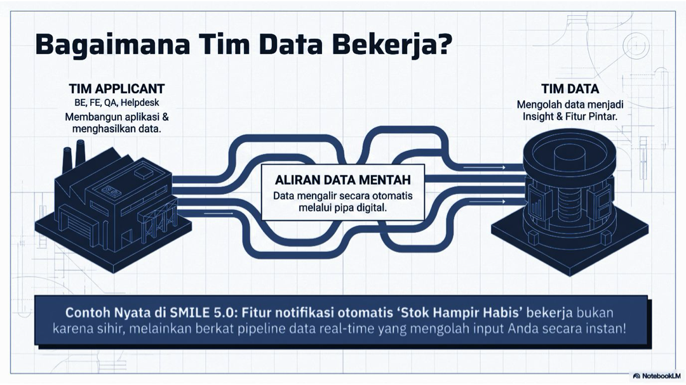

_Ilustrasi alur data dari application layer hingga menjadi actionable insight._

### 3. Peran dalam Ekosistem Data

- **Data Architect** — merancang blueprint data enterprise dan framework tata kelola.
- **Data Engineer** — membangun, mengotomatisasi, dan memelihara pipeline data berskala besar.
- **Analytics Engineer** — mengubah data mentah menjadi model SQL yang modular.
- **Data Analyst** — menganalisis data historis untuk menghasilkan insight bisnis.
- **BI Developer** — membuat KPI interaktif dan dashboard operasional.
- **Business Analyst** — menerjemahkan kebutuhan bisnis menjadi kebutuhan teknis.
- **Data Scientist** — menggunakan statistik lanjutan untuk memprediksi tren.
- **ML Engineer** — menerapkan model machine learning yang dapat berjalan di production.

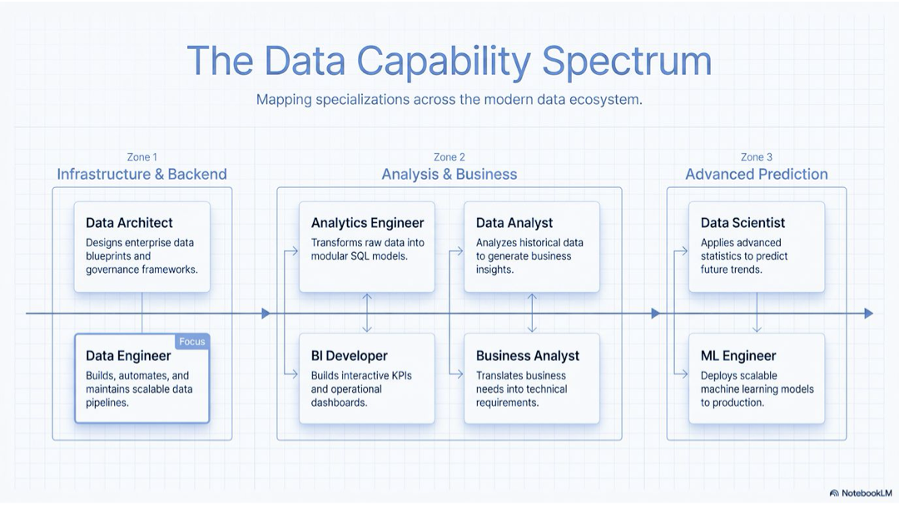

_Spektrum peran dan spesialisasi dalam ekosistem data modern._

### 4. Arsitektur Dasar Pipeline Data

Data engineer berperan sebagai pengelola aliran data dari sumber hingga siap digunakan:

- **Ingest** — mengambil data dari API, database, atau sumber lain.
- **Transform** — membersihkan data kotor, menghapus duplikasi, dan menyeragamkan format.
- **Serve** — mendistribusikan data ke dashboard, aplikasi, atau model machine learning.

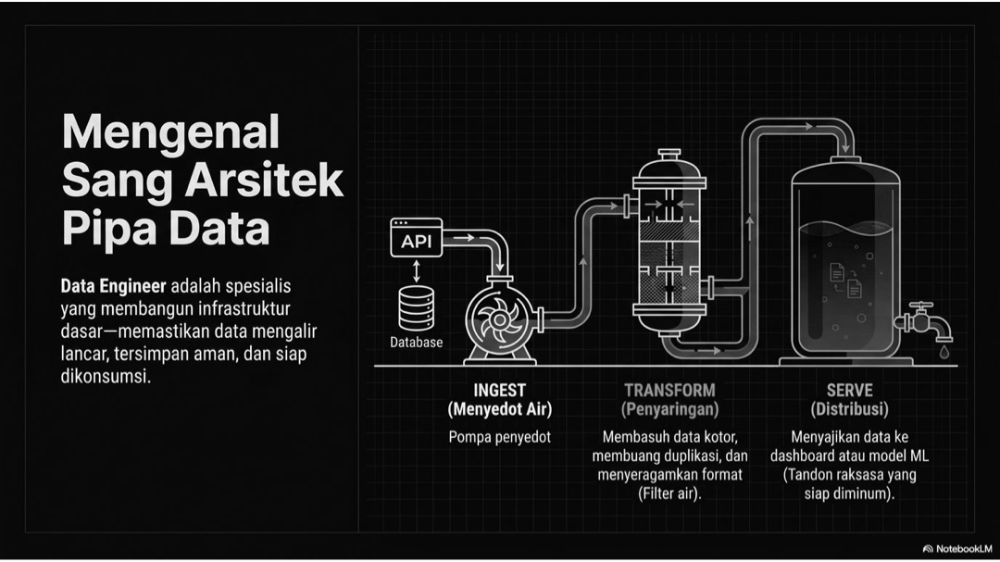

_Ilustrasi tahapan ingest, transform, dan serve._

### 5. Lapisan Data Engineering Modern

Gambaran lapisan yang umum terdapat pada data pipeline:

1. Ingestion
2. Storage
3. Processing
4. Transformation
5. Orchestration
6. Warehouse
7. Quality & Governance

Contoh tools yang diperkenalkan pada materi:

- Kafka, Airbyte, Fivetran, dan Debezium
- Amazon S3, Google Cloud Storage, dan Azure Data Lake
- Apache Spark, Apache Flink, dan Databricks
- dbt, SQLMesh, dan Coalesce
- Apache Airflow, Dagster, dan Prefect
- Snowflake, BigQuery, Databricks, dan Amazon Redshift

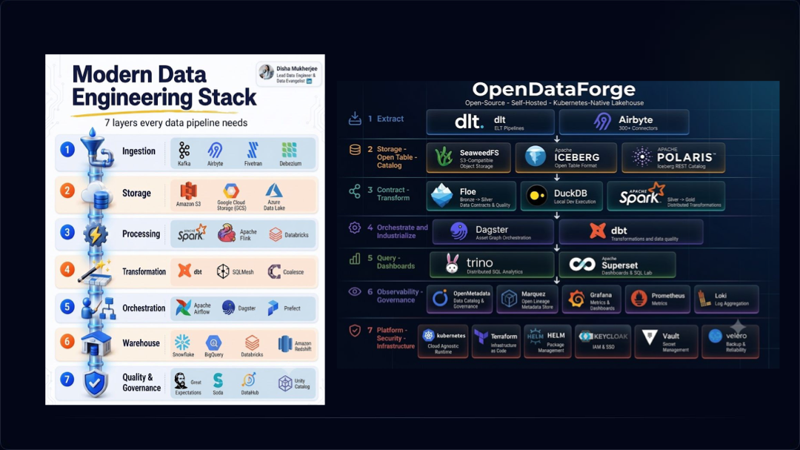

_Contoh lapisan dan tools dalam modern data engineering stack._

### 6. Jenjang Kemampuan Data Engineer

- **Beginner Data Engineer** — SQL, Python, Linux, dan database.
- **Junior Data Engineer** — ETL/ELT, data warehousing, API, Git, dan scheduling.
- **Mid-Level Data Engineer** — orchestration, dbt, Spark, Kafka, cloud storage, dan data modeling.
- **Senior Data Engineer** — distributed systems, cloud architecture, streaming, governance, dan optimization.
- **Modern AI-Ready Data Engineer** — vector database, RAG pipelines, feature stores, LLM data workflows, dan data quality.

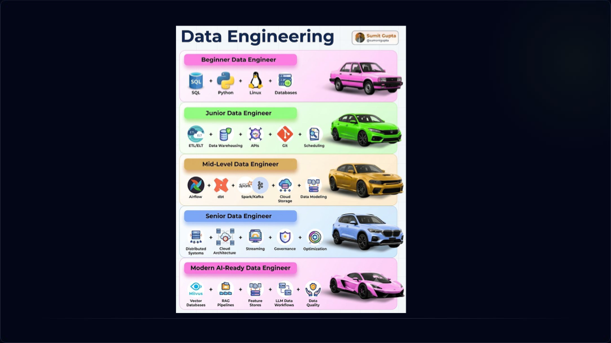

_Gambaran jenjang kemampuan dari beginner hingga modern AI-ready data engineer._

### 7. Paradigma Pipeline Data

#### ETL — Extract, Transform, Load

ETL mengambil data dari berbagai sumber, membersihkan dan mengubah data sebelum data dimuat ke database atau data warehouse.

Alur umum ETL:

1. **Extract** — mengambil data dari aplikasi, database seperti MySQL/PostgreSQL, API, Google Analytics, atau file Excel.
2. **Transform** — melakukan filtering, membersihkan nilai `NULL`, menghapus duplikasi, dan menyeragamkan tipe data.
3. **Load** — menyimpan data yang sudah siap ke database atau data warehouse untuk digunakan lebih lanjut.

ETL cocok ketika transformasi perlu dilakukan sebelum data masuk ke target, misalnya karena data sensitif perlu dimasking, volume data perlu dikurangi, atau kemampuan komputasi target terbatas.

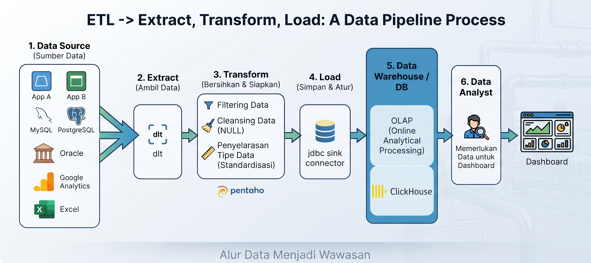

_Diagram ETL dari sumber data hingga dashboard._

#### ELT — Extract, Load, Transform

ELT mengambil data dari sumber dan langsung memuat data mentah ke data warehouse. Transformasi dilakukan setelah data berada di dalam warehouse menggunakan SQL atau tools seperti dbt.

Alur umum ELT:

1. **Extract** — mengambil data dari sumber.
2. **Load** — memuat data mentah ke data warehouse.
3. **Transform** — melakukan filtering, cleansing, standardisasi, join, atau agregasi di dalam data warehouse.

ELT cocok ketika data warehouse memiliki kemampuan komputasi yang kuat, data mentah perlu dipertahankan untuk banyak kebutuhan analisis, atau aturan bisnis sering berubah.

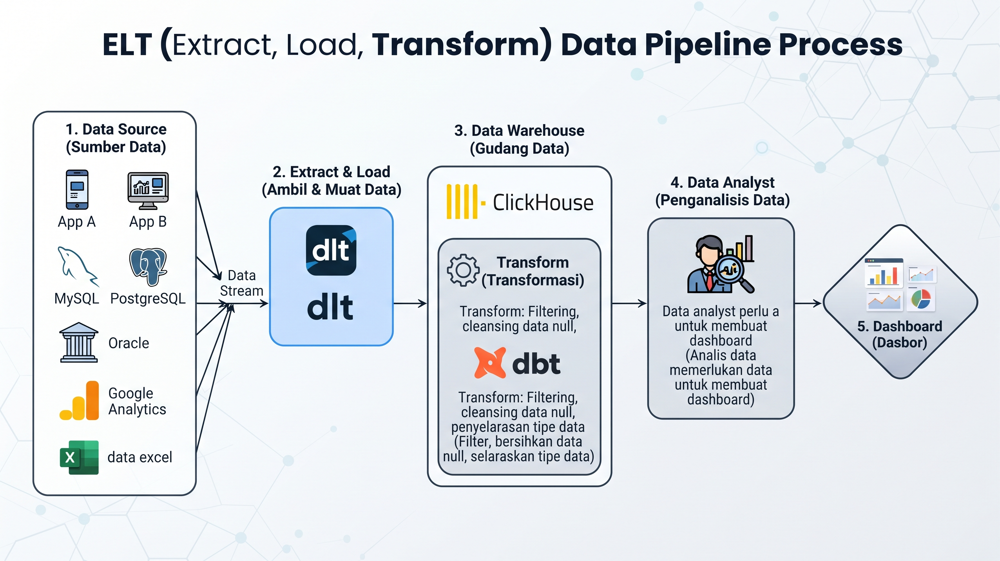

_Diagram ELT dengan transformasi dilakukan di data warehouse._

#### ETLT — Extract, Transform, Load, Transform

ETLT adalah pola hybrid yang membagi transformasi menjadi dua tahap. Transformasi awal dilakukan sebelum data dimuat, kemudian transformasi lanjutan dilakukan setelah data berada di data warehouse.

Alur umum ETLT:

1. **Extract** — mengambil data dari sumber.
2. **Transform awal** — melakukan masking data sensitif, standardisasi, filtering, atau pembersihan dasar.
3. **Load** — memuat data dasar yang sudah lebih aman dan konsisten ke data warehouse.
4. **Transform lanjutan** — melakukan join, agregasi, dan pembentukan data mart di dalam target.

ETLT cocok ketika sebagian transformasi harus dilakukan sebelum data masuk ke warehouse, tetapi transformasi kompleks tetap lebih efisien jika dilakukan di dalam warehouse.

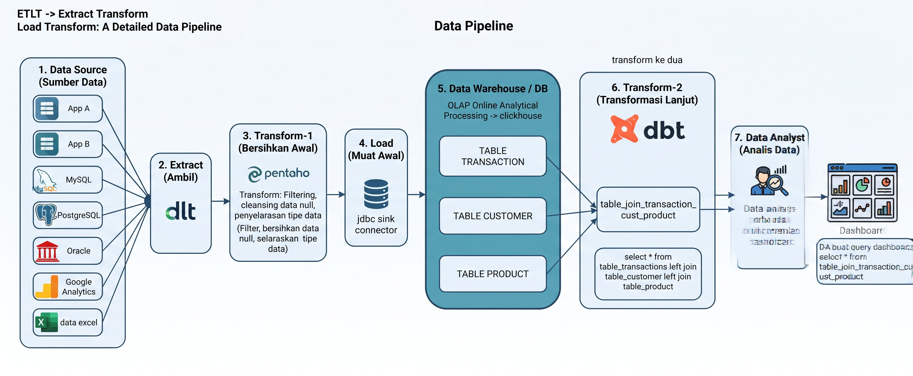

_Diagram ETLT dengan transformasi awal dan transformasi lanjutan._

#### Reverse ETL

Reverse ETL mengalirkan data dari data warehouse kembali ke sistem operasional atau tools bisnis. Pola ini merupakan kebalikan dari pipeline data yang biasanya mengumpulkan data dari sistem operasional ke warehouse.

Alur umum Reverse ETL:

1. Data dikumpulkan dan diolah di data warehouse.
2. Hasil analisis atau segmentasi disiapkan untuk kebutuhan operasional.
3. Data dikirim ke CRM, aplikasi, tools marketing, atau sistem operasional lainnya.

Contohnya adalah mengirim segmentasi pelanggan dari data warehouse ke CRM, mengirim daftar pelanggan untuk kampanye marketing, atau mengirim indikator risiko ke aplikasi operasional.

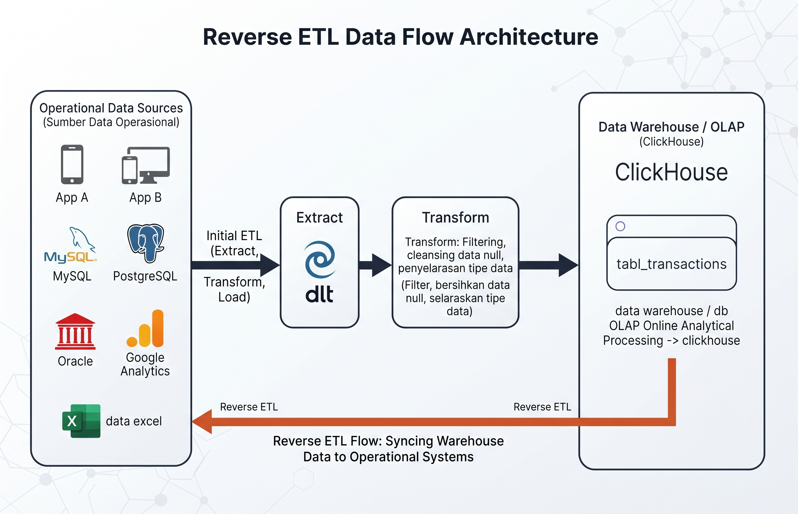

_Diagram Reverse ETL dari data warehouse kembali ke sistem operasional._

#### Perbandingan Singkat

| Pola | Lokasi transformasi | Kapan digunakan |
|---|---|---|
| ETL | Sebelum data masuk ke target | Data perlu dibersihkan, dimasking, atau diperkecil lebih dahulu |
| ELT | Setelah data masuk ke warehouse | Target memiliki komputasi kuat dan data mentah perlu dipertahankan |
| ETLT | Sebelum dan sesudah load | Membutuhkan kombinasi transformasi awal dan transformasi lanjutan |
| Reverse ETL | Dari warehouse ke sistem operasional | Hasil analitik perlu digunakan kembali oleh aplikasi atau tim bisnis |

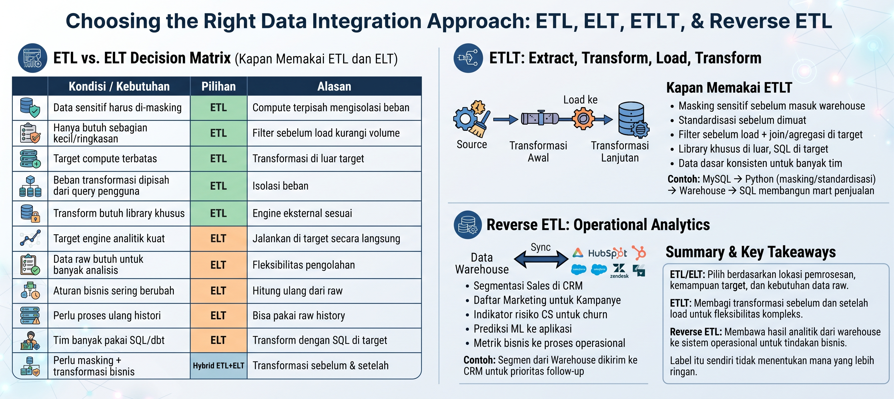

_Ringkasan perbandingan pola integrasi data._


### 8. Pola Pemrosesan Data

- **Batch** — data dikumpulkan dan diproses secara berkala dengan latensi sekitar 4–24 jam.
- **Micro-batch** — data diproses dalam kelompok kecil secara berkala dengan latensi sekitar 1–15 menit.
- **Streaming** — setiap event diproses saat transaksi terjadi dengan latensi detik hingga milidetik.

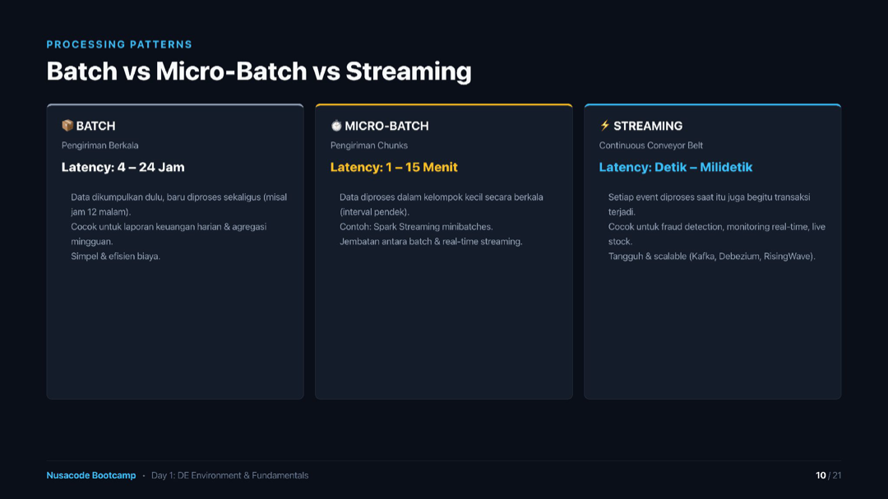

_Perbandingan batch, micro-batch, dan streaming._

### 9. Studi Kasus Real-Time Streaming

Contoh arsitektur pipeline real-time:

1. **MySQL** sebagai database transaksi utama.
2. **Debezium** membaca binlog MySQL dan mengubah perubahan transaksi menjadi event stream.
3. **Kafka** sebagai message broker dan penampung event stream.
4. **RisingWave** sebagai stream SQL engine untuk pemrosesan kontinu dan materialized view.
5. **Datamart** sebagai tempat hasil agregasi real-time yang dikonsumsi dashboard.

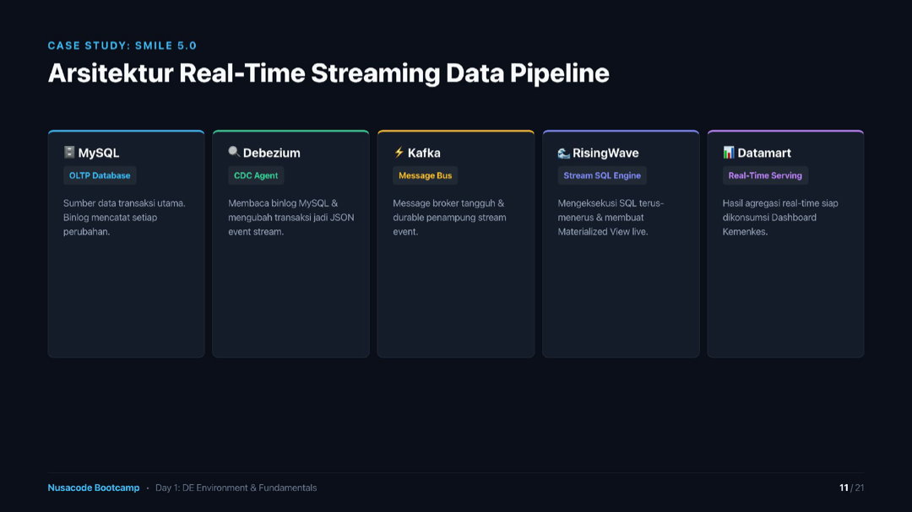

_Contoh arsitektur real-time streaming data pipeline._

### 10. Empat Fondasi Data Engineer

#### Python

Python adalah bahasa pemrograman yang digunakan untuk menulis instruksi pengolahan data dan membangun pipeline ETL/ELT. Dalam data engineering, Python dapat digunakan untuk membaca file, mengambil data dari API atau database, membersihkan data, melakukan transformasi, menangani error, dan menjalankan proses secara otomatis.

Contoh peran Python dalam pipeline:

- Membaca data dari CSV atau sumber lainnya.
- Melakukan filtering dan transformasi data.
- Menghubungkan pipeline ke database.
- Menyimpan hasil transformasi ke data warehouse.
- Menjalankan proses ETL secara berulang.

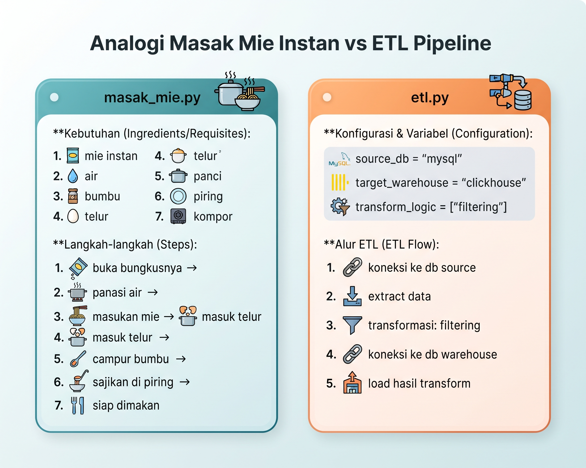

_Python dianalogikan seperti resep masakan: berisi langkah-langkah terurut untuk mengolah bahan mentah menjadi hasil akhir._

#### Docker

Docker adalah teknologi untuk menjalankan aplikasi dan dependensinya di dalam container yang terisolasi. Container membantu membuat environment yang konsisten sehingga aplikasi dapat berjalan dengan konfigurasi yang sama di komputer yang berbeda.

Dalam data engineering, Docker dapat digunakan untuk menjalankan PostgreSQL, MySQL, Kafka, Airflow, atau komponen pipeline lainnya tanpa harus melakukan instalasi manual satu per satu.

Manfaat Docker:

- Menyediakan environment yang portable.
- Mengurangi perbedaan konfigurasi antar-komputer.
- Memudahkan setup database dan tools data engineering.
- Membantu menjalankan beberapa service secara terisolasi.

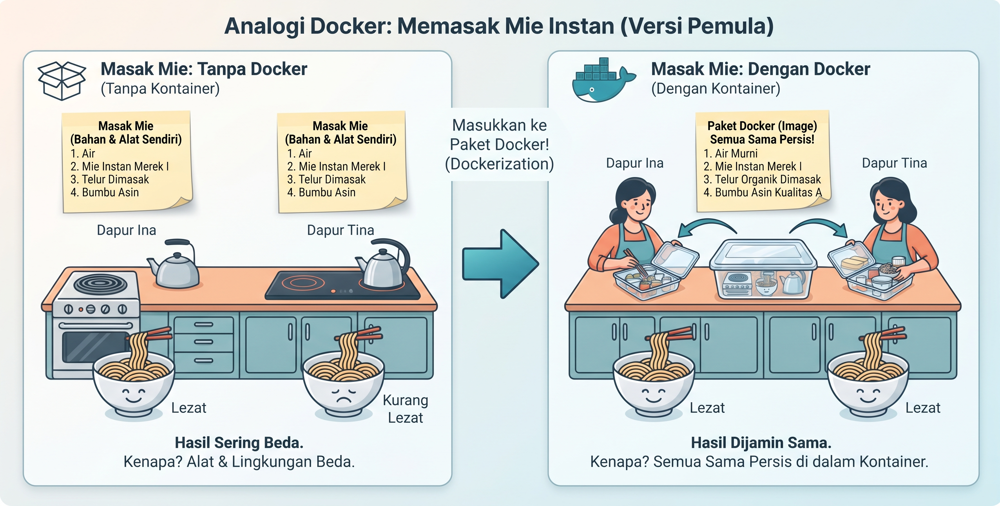

_Docker dianalogikan seperti container atau paket dapur yang membawa semua bahan dan alat agar hasilnya konsisten._

#### CLI (Command Line Interface)

CLI adalah antarmuka berbasis teks untuk berinteraksi dengan sistem operasi dan tools. Data engineer menggunakan CLI untuk menavigasi folder, mengelola file, menjalankan script, mengontrol container Docker, dan menjalankan proses di server.

#### Git

Git adalah version control system yang mencatat perubahan pada kode dan file project. Git membantu tim menyimpan riwayat versi, mengetahui perubahan yang dibuat, berkolaborasi melalui branch, melakukan rollback, dan mengirim perubahan ke repository remote seperti GitHub atau GitLab.

Alur dasar Git:

1. Membuat atau mengubah file di repository lokal.
2. Menyimpan perubahan ke staging area dengan `git add`.
3. Membuat catatan versi dengan `git commit`.
4. Mengirim perubahan ke repository remote dengan `git push`.
5. Mengambil perubahan dari repository remote dengan `git pull`.

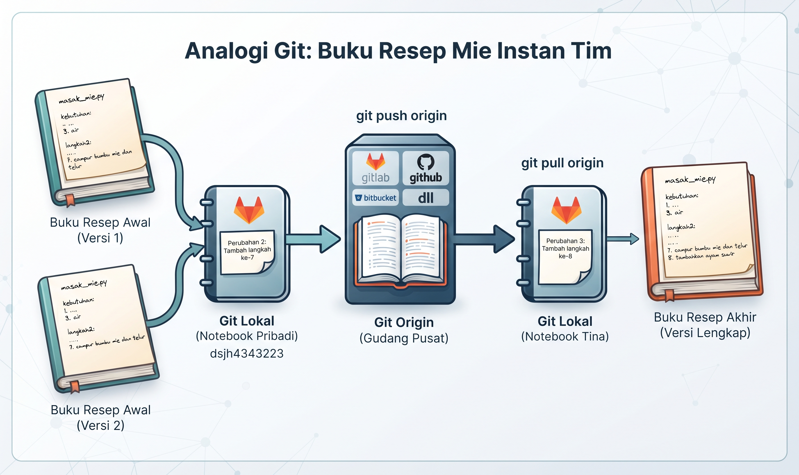

_Git dianalogikan seperti buku resep bersama yang menyimpan versi resep lokal dan repository pusat._

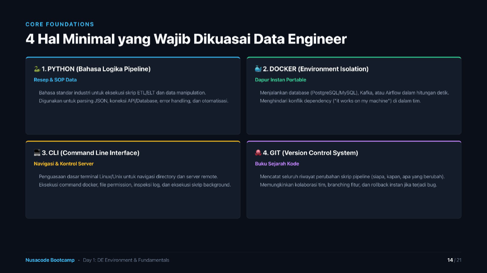

_Empat fondasi yang diperkenalkan: Python, Docker, CLI, dan Git._

## Analogi Tools Data Engineering

Materi menggunakan analogi dapur untuk menjelaskan tools:

- Script Python seperti SOP atau resep masakan.
- Docker seperti dapur portable yang sudah berisi peralatan dan bahan yang diperlukan.
- Git seperti buku sejarah resep yang mencatat siapa, kapan, dan apa yang berubah.

## Perintah Dasar CLI

| Command | Arti | Kegunaan |
|---|---|---|
| `pwd` | Print Working Directory | Mengecek lokasi folder saat ini |
| `ls -la` | List All | Menampilkan semua file, termasuk file tersembunyi |
| `mkdir` | Make Directory | Membuat folder baru untuk project |
| `cd ..` | Change Directory Up | Naik satu tingkat ke folder induk |

## Setup Docker PostgreSQL

Materi memperkenalkan konfigurasi `docker-compose.yml` untuk database PostgreSQL:

- Image: `postgres:15-alpine`
- Port: `5432:5432`
- Menjalankan container dalam detached mode dengan command:

```bash
docker-compose up -d
```

## Exception Handling dan Logging

Pipeline yang gagal di tengah proses dapat menyebabkan data berikutnya tidak ikut diproses. Karena itu, materi membahas:

- **Try block** untuk membungkus kode yang rentan error.
- **`ZeroDivisionError`** untuk menangani pembagian dengan nol.
- **`KeyError`** untuk menangani kolom atau key dictionary yang tidak ditemukan.
- **Graceful degradation** agar data yang bermasalah dilewati dan proses tetap berjalan.
- **`print()`** untuk output sementara di terminal.
- **Logging** untuk menyimpan output secara permanen, termasuk timestamp.
- **Log level** seperti `INFO`, `ERROR`, dan `CRITICAL`.

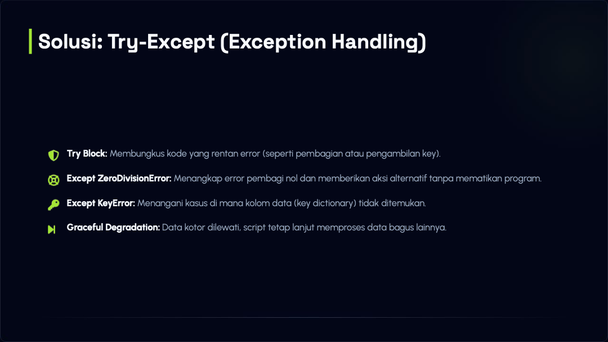

_Konsep dasar penanganan error pada pipeline._

## Git Workflow

Alur dasar Git yang diperkenalkan:

1. `git add` — membungkus perubahan ke staging area.
2. `git commit -m "pesan"` — memberi label pada perubahan.
3. `git push` — mengirim perubahan ke repository remote atau GitHub.

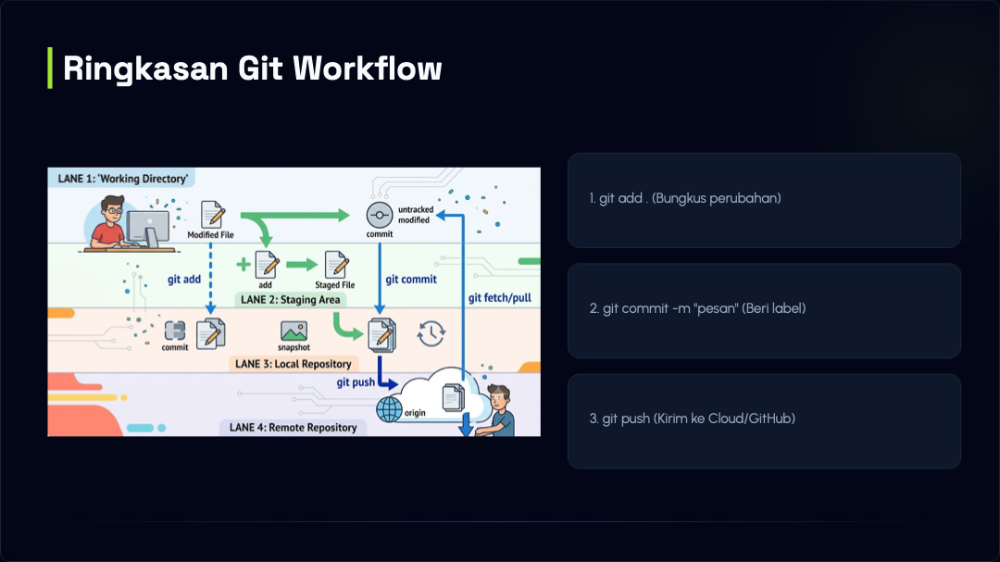

_Alur perubahan dari working directory sampai remote repository._

## Tugas

- Mengeksplorasi perbedaan OLAP dan OLTP.
- Mencoba menjalankan host dari Docker secara lokal.
